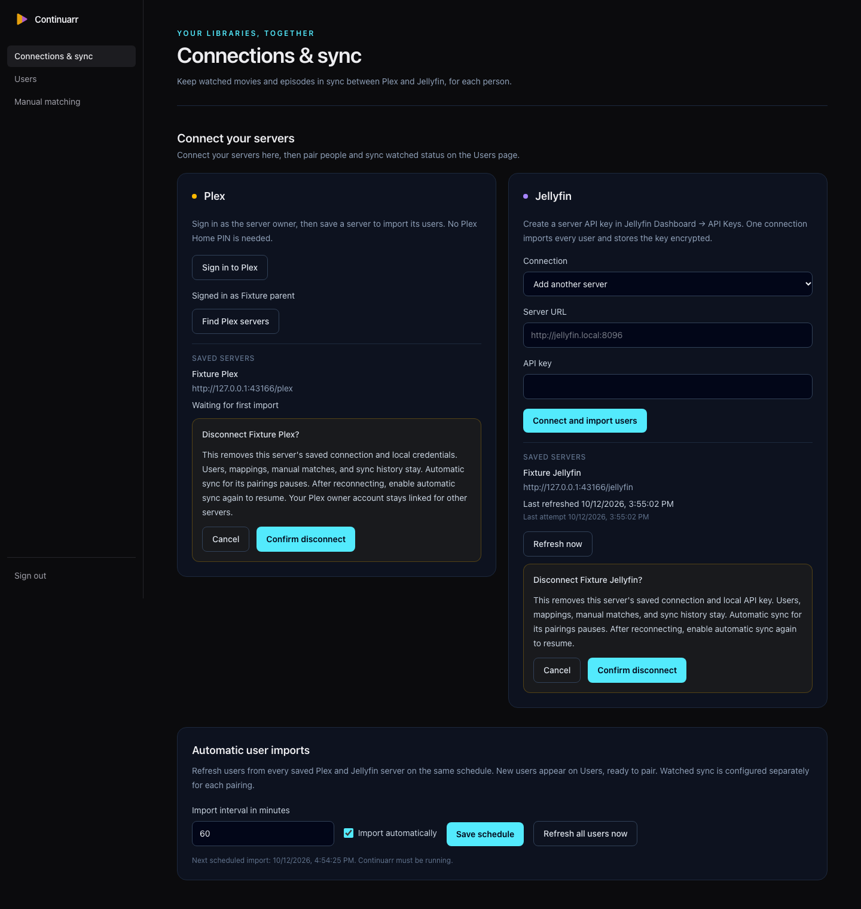
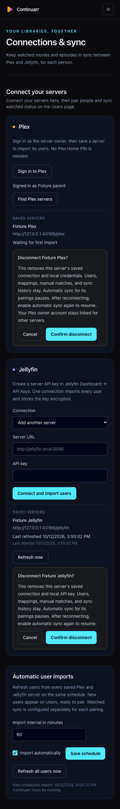
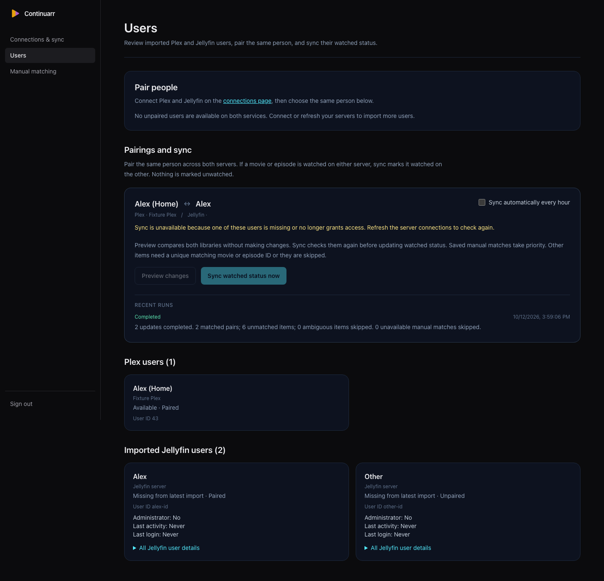
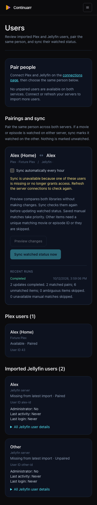

# Safe disconnect verification

Verified against the isolated PostgreSQL and media fixtures with app port 3066 and fixture port 43166. All names, URLs, and records in the screenshots are disposable fixture data.

## Checks

| Command | Result |
| --- | --- |
| `bun install --frozen-lockfile` | PASS |
| `bun test src/backend/media/service.test.ts src/backend/secrets/storage.test.ts` | PASS, 81 tests, 0 failures |
| `bun test` | PASS, 193 tests, 0 failures |
| `bun run check` | PASS. Existing Biome schema-version information remains. |
| `bun run typecheck` | PASS |
| `bun run db:check` | PASS |
| `bun run test:pr-size` | PASS, 16 tests, 0 failures |
| `bun run build` | PASS |
| `git diff --check` | PASS |
| `node /tmp/continuarr-issue-66/browser/verify.mjs` | PASS, seven UI/API scenario checks |
| `node /tmp/continuarr-issue-66/browser/verify-selected-form.mjs` | PASS, selected Jellyfin replacement fields clear after disconnect |

The browser scripts and raw evidence remain in `/tmp/continuarr-issue-66`. They are local verification artifacts. The committed service tests provide repeatable coverage for both providers, reconnect identity, credential removal, legacy copies, unaffected connections, startup backfill, stale requests, active sync rejection, and protected HTTP responses.

## Observed behavior

- Desktop at 1440 pixels and mobile at 390 pixels show named confirmation with Cancel and Confirm disconnect. Cancel retains both connections. Mobile has no horizontal overflow.
- Confirmed Jellyfin disconnect removes its server row and encrypted key. Retained profiles have null connection references, null legacy credential copies, and missing presence. Pairing IDs, profile IDs, the saved manual match, and the completed run remain unchanged in PostgreSQL.
- Reloaded Users shows the affected pairing unavailable with preview and sync disabled. An authenticated API preview returns 400. Watched IDs on the fixtures remain unchanged.
- Jellyfin reconnect through the UI restores the same user and pairing IDs and enables preview. The API library read returns the original manual match. Automatic sync remains off.
- Confirmed Plex disconnect removes the configured fixture server row and clears its profile grants. Retained profiles become missing and unavailable. Pairing, match, and history remain. Preview returns 400 and the UI sync controls are disabled.
- Disconnecting the selected Jellyfin replacement clears its URL and entered key and restores Connect and import users.
- Both DELETE actions reject an unauthenticated same-origin request with 401 and an authenticated foreign-origin request with 403. An authenticated same-origin repeated deletion returns 200 with only the saved connection ID. Responses contain no stored credentials or encrypted envelopes. The focused secret suite verifies serialization, inspection, and sensitive error redaction.
- The Playwright browser reported no page errors.

Representative protected response after confirmation:

```text
DELETE /api/v1/media/plex/fixture-saved-plex
200 {"id":"fixture-saved-plex"}
```

## Limits

T3 preview completed owner setup and the initial Jellyfin import, then lost its automation host. Its snapshot calls also failed. A separate Playwright context completed the UI checks and captured these screenshots.

The configured Plex row was seeded as a fixture prerequisite. Real Plex OAuth and browser reconnect were not exercised. Service tests exercise Plex reconnect through mocked external provider boundaries and real PostgreSQL persistence.

Disconnect pauses current automatic pairings. An already-read scheduler snapshot or a later request to the existing automatic-setting API can still attempt a failed run. Cleared credentials prevent provider reads and writes. Scheduler and pairing presentation remain outside this issue's ownership.

## Screenshots








